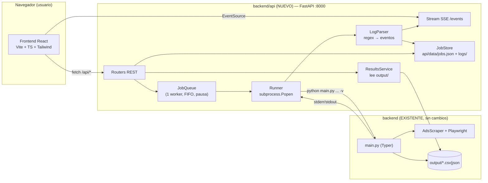
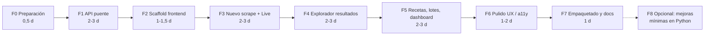

# Roadmap — Interfaz web para Meta Ads Library Scraper

> **Objetivo:** dotar al scraper Python actual (`backend/`) de una interfaz web moderna construida con **Vite + React + TypeScript + Tailwind CSS**, **sin modificar el código Python existente** (o con cambios mínimos, opcionales y aislados).

Documentos relacionados:

| Documento | Contenido |
| --- | --- |
| [ROADMAP.md](./ROADMAP.md) | Visión, arquitectura, decisiones, fases, hitos y criterios de aceptación (este documento) |
| [SPEC-API.md](./SPEC-API.md) | Especificación de la capa puente (API FastAPI): endpoints, modelos, eventos SSE, parser de logs, runner |
| [SPEC-FRONTEND.md](./SPEC-FRONTEND.md) | Especificación del frontend: stack, estructura, pantallas, componentes, estado, diseño |

---

## 1. Análisis del estado actual

### 1.1 Qué hay hoy

```
backend/
├── main.py              # CLI Typer — único punto de entrada (`scrape`)
├── config.py            # Constantes (valores válidos, timeouts, HEADLESS, OUTPUT_DIR="output")
├── models/ad.py         # Modelo Pydantic `Ad` (14 campos)
├── scraper/             # AdsScraper (Playwright async), parser, paginación, utils
├── exporters/           # CsvExporter (pandas, utf-8-sig) y JsonExporter
├── output/              # Ficheros generados: <label>[_ig_profiles]_<YYYYMMDD_HHMMSS>.<csv|json>
└── docs/Own Plugin.md   # Guía de uso avanzado (recetas, países, reglas anti-bloqueo)
```

### 1.2 Contrato real del backend (lo que la UI debe respetar)

| Aspecto | Comportamiento actual | Implicación para la UI |
| --- | --- | --- |
| Entrada | CLI `python main.py` con flags (`-k/-p/-s`, `-c`, `-st`, `-pl`, `-m`, `-md`, `-e`, `-ig`, `-f`, `-l`, `-v`) | La API construirá exactamente esos argumentos |
| Modo de búsqueda | Exactamente **uno** de `--keyword`, `--page-url`, `--slug` | Selector exclusivo (tabs / radio) en el formulario |
| Validación | `status ∈ {active, inactive, all}`, `platform ∈ {instagram, facebook, messenger, audience_network}` o nada, `media ∈ {all, video, image, memes, none}`, `min-date` = `YYYY-MM-DD`, `limit ≥ 1`, `format ∈ {csv, json}` | Replicar en el cliente (zod) y en la API (Pydantic) leyendo `config.py` |
| Progreso | **No hay callbacks.** Solo logs Loguru a `stderr` (con `-v` se emiten líneas DEBUG por iteración de scroll) | El progreso se obtiene **parseando los logs** del proceso |
| Logs | Loguru con `colorize=True` → incluye códigos ANSI incluso sin TTY | El parser debe eliminar secuencias ANSI |
| Resultado | Al final imprime en `stdout`: `Done. Output written to: <ruta>` | La API extrae la ruta del fichero generado de esa línea |
| Códigos de salida | `0` OK · `0` sin resultados (`No ads matched the criteria.`, sin fichero) · `1` error · `130` interrumpido | Estados finales: `succeeded`, `empty`, `failed`, `cancelled` |
| Rutas | `OUTPUT_DIR = "output"` es **relativo al cwd**; imports absolutos (`from config import …`) | El proceso debe ejecutarse con `cwd=backend/` |
| Exportación | Solo al final del scrape | Cancelar un trabajo = se pierden los resultados parciales (avisar en UI) |
| Concurrencia | Un navegador Chromium por ejecución; Meta aplica rate-limit | Cola **secuencial** (1 trabajo a la vez) + pausa configurable entre trabajos |

### 1.3 Observaciones del código (no bloquean, no se tocan en el MVP)

- En `scraper/ads_scraper.py` hay un decorador `@retry` "huérfano" (líneas ~239-250) que queda aplicado a `_dismiss_cookie_banner`. Es inocuo, pero conviene saberlo.
- `backend/README.md` tiene la tabla de opciones desactualizada (faltan `--status`, `--platform`, `--media`, `--min-date`, `--exact`, `--only-ig-profile`). La fuente de verdad es `main.py` y `docs/Own Plugin.md`.
- El repo está en plena migración a `backend/` (git muestra los ficheros raíz como eliminados y `backend/` sin seguimiento). Hay que **consolidar ese commit antes de empezar** (Fase 0).
- Las URLs de vídeo/imagen de `fbcdn.net` **caducan** (parámetro `oe=` hexadecimal = timestamp de expiración). La UI debe tratarlas como volátiles y ofrecer siempre `snapshot_url` como alternativa.

---

## 2. Decisión de arquitectura

### 2.1 Opciones evaluadas

| Opción | Descripción | Cambios en Python | Veredicto |
| --- | --- | --- | --- |
| A. Importar `AdsScraper` dentro de un servidor web | FastAPI llama a `AdsScraper(...).run()` en el mismo proceso | Ninguno, pero… | ❌ Loguru es global (logs de jobs mezclados), problemas de event loop de Playwright en Windows con uvicorn, cancelación difícil, un crash tumba la API |
| **B. API puente que ejecuta el CLI como subproceso** | FastAPI lanza `python main.py …` con `subprocess`, lee `stdout/stderr`, parsea progreso y lo emite por SSE | **Ninguno** | ✅ **Elegida** |
| C. Reescribir el backend como servicio | Refactor a librería con callbacks/eventos | Muchos | ❌ Contradice el requisito principal |

### 2.2 Por qué la opción B

1. **Cero cambios** en el código que funciona: el CLI sigue siendo la fuente de verdad y sigue pudiéndose usar a mano.
2. **Aislamiento total:** cada scrape es un proceso independiente (logs propios, memoria propia, si falla no afecta a la API).
3. **Cancelación fiable:** se mata el árbol de procesos (Python + Chromium) con `taskkill /T /F` en Windows.
4. **Compatibilidad Windows:** usando `subprocess.Popen` + hilos lectores se evita el problema de `asyncio` subprocess con `SelectorEventLoop` (uvicorn `--reload`).
5. **Fichero de salida como contrato:** la UI lee lo que el CLI ya genera en `output/`, así el historial incluye también los scrapes lanzados por terminal.

### 2.3 Arquitectura objetivo



### 2.4 Estructura de repositorio objetivo

```
Meta-Ads-Library-Scrapper/
├── README.md                  # Cómo arrancar todo (actualizar en Fase 7)
├── docs/                      # ← Este roadmap y las especificaciones
│   ├── ROADMAP.md
│   ├── SPEC-API.md
│   └── SPEC-FRONTEND.md
├── backend/                   # Código Python EXISTENTE (no se modifica)
│   ├── main.py, config.py, models/, scraper/, exporters/, output/
│   ├── requirements.txt       # Sin cambios
│   ├── requirements-api.txt   # NUEVO: fastapi, uvicorn
│   └── api/                   # NUEVO: capa puente
│       ├── __init__.py
│       ├── server.py          # App FastAPI, CORS, montaje de estáticos
│       ├── settings.py        # Rutas, puertos, pausa entre jobs, etc.
│       ├── schemas.py         # Pydantic: ScrapeRequest, Job, ResultFile...
│       ├── options.py         # Lee config.py + catálogo de países y recetas
│       ├── command.py         # ScrapeRequest → lista de argumentos CLI
│       ├── runner.py          # Popen, hilos lectores, cancelación
│       ├── log_parser.py      # ANSI strip + regex → eventos tipados
│       ├── jobs.py            # JobQueue + JobStore + pub/sub para SSE
│       ├── results.py         # Listado/lectura/borrado de output/
│       ├── routers/           # health, options, jobs, batches, results
│       ├── data/              # jobs.json + logs/<job_id>.log (git-ignored)
│       └── tests/             # pytest (con CLI falso)
├── frontend/                  # NUEVO: Vite + React + TS + Tailwind
└── scripts/
    ├── dev.ps1                # Arranca API + Vite en paralelo
    └── start.ps1              # Modo producción: build + API sirviendo el dist
```

> [!NOTE]
> `backend/api/` es un paquete **nuevo** dentro de `backend/`: no se edita ningún fichero existente. Se coloca ahí para compartir el mismo `venv` e importar `config.py` (solo constantes, import seguro) para exponer los valores válidos.

---

## 3. Stack tecnológico

| Capa | Tecnología | Motivo |
| --- | --- | --- |
| API | **FastAPI** + **Uvicorn** | Async, Pydantic v2 (ya usado en el proyecto), OpenAPI automático para generar tipos TS |
| Streaming | **Server-Sent Events** (`StreamingResponse`, `text/event-stream`) | Unidireccional servidor→cliente, reconexión nativa con `EventSource`, más simple que WebSocket |
| Persistencia | Ficheros JSON + `.log` en `backend/api/data/` | Herramienta local mono-usuario; sin base de datos |
| Frontend build | **Vite** | Requisito; HMR rápido, proxy de desarrollo |
| UI | **React 19 + TypeScript (strict)** | Requisito + seguridad de tipos |
| Estilos | **Tailwind CSS v4** (`@tailwindcss/vite`) + componentes estilo **shadcn/ui** (Radix) | Requisito; componentes accesibles y personalizables en el propio repo |
| Routing | **React Router** | Navegación entre pantallas |
| Server state | **TanStack Query** | Caché, reintentos, invalidación tras mutaciones |
| Tablas | **TanStack Table** + **TanStack Virtual** | Ordenar/filtrar/columnas/virtualización para miles de filas |
| Formularios | **react-hook-form** + **zod** | Validación espejo de `main.py` |
| Iconos / toasts | **lucide-react**, **sonner** | Ligeros |
| Tipos API | **openapi-typescript** | Tipos TS generados desde `/openapi.json` (contrato único) |
| Calidad | ESLint, Prettier, Vitest + Testing Library, Playwright (e2e opcional), pytest + ruff | |

---

## 4. Alcance funcional

### 4.1 MVP (imprescindible)

1. **Nuevo scrape**: formulario con todos los parámetros del CLI, validación y vista previa del comando equivalente.
2. **Seguimiento en vivo**: estado, fase, barra de progreso (`total / limit`), contadores, consola de logs en streaming, botón cancelar.
3. **Historial de resultados**: listado de ficheros de `output/` (también los generados desde terminal) con metadatos, descarga y borrado.
4. **Explorador de resultados**: tabla con búsqueda, ordenación, filtros, columnas configurables, deduplicación por `ig_username`/`page_id`, exportación de la vista filtrada.

### 4.2 Fase 2 (alto valor)

5. **Recetas/presets**: las recetas de `Own Plugin.md` (Lead Gen IG, anuncios ganadores, barrido por dolores, embudos externos) como plantillas de un clic + presets guardados por el usuario.
6. **Lotes (batch)**: varias keywords con los mismos filtros, ejecutadas en cola con **pausa anti-bloqueo** (por defecto 150 s, regla "2-3 minutos" de la guía).
7. **Enriquecimiento en cliente**: días activo, tipo de destino (`instagram`, `whatsapp`, `calendly`, `web`, etc.), "anuncio ganador" (activo > N días), copiar lista de `@usuarios`.
8. **Dashboard**: métricas agregadas (perfiles únicos, top anunciantes, distribución por destino/plataforma).

### 4.3 Fuera de alcance (por ahora)

- Multiusuario, autenticación, despliegue en servidor público.
- Ejecución de varios scrapes en paralelo.
- Resolución de CAPTCHAs o rotación de proxies.

---

## 5. Roadmap por fases



Estimación total MVP (F0-F4): **~8-11 días**. Completo (F0-F7): **~12-17 días** de un desarrollador.

---

### Fase 0 — Preparación del repositorio (0,5 días)

**Tareas**
- [ ] Consolidar en git la migración a `backend/` (commit `chore: move scraper to backend/`).
- [ ] Crear `.gitignore` raíz (node_modules, dist, `backend/api/data/`, `.venv`).
- [ ] Verificar que el CLI funciona desde `backend/`: `cd backend; python main.py -k test -l 5 -f json -v`.
- [ ] Crear `docs/` (este roadmap) y `scripts/`.
- [ ] Definir versiones: Python ≥ 3.11, Node ≥ 20 LTS, pnpm o npm.

**Criterio de aceptación:** `git status` limpio; el CLI produce un fichero en `backend/output/`.

---

### Fase 1 — API puente FastAPI (2-3 días)

Detalle completo en [SPEC-API.md](./SPEC-API.md).

**Tareas**
- [ ] `requirements-api.txt` (`fastapi`, `uvicorn[standard]`, `pytest`, `httpx`).
- [ ] `settings.py`: `BACKEND_DIR`, `OUTPUT_DIR` absoluto, `DATA_DIR`, `PYTHON_EXE = sys.executable`, `JOB_PAUSE_SECONDS`, `HOST=127.0.0.1`, `PORT=8000`.
- [ ] `schemas.py`: `ScrapeRequest`, `Job`, `JobStatus`, `JobPhase`, `JobProgress`, `ResultFile`, `BatchRequest`, `OptionsResponse`.
- [ ] `options.py`: exponer `VALID_*`, defaults de `config.py`, catálogo de países (de `Own Plugin.md`) y recetas.
- [ ] `command.py`: `ScrapeRequest → list[str]` (siempre añade `-v`; nunca `shell=True`).
- [ ] `runner.py`: `Popen` con `cwd=backend/`, `PYTHONUTF8=1`, `PYTHONIOENCODING=utf-8`, `PYTHONUNBUFFERED=1`; hilos lectores de stdout/stderr; cancelación con `taskkill /PID <pid> /T /F` (Windows) o `killpg` (POSIX).
- [ ] `log_parser.py`: strip ANSI + tabla de regex → eventos (`phase`, `progress`, `log`, `result`, `warning`).
- [ ] `jobs.py`: cola FIFO con 1 worker, pausa entre jobs, persistencia en `data/jobs.json`, log completo en `data/logs/<id>.log`, pub/sub para SSE con *replay* del histórico al conectar.
- [ ] `results.py`: listar/leer/borrar ficheros de `output/` con protección contra *path traversal*.
- [ ] Routers: `/api/health`, `/api/options`, `/api/jobs*`, `/api/batches*`, `/api/results*`.
- [ ] CORS solo para `http://localhost:5173`.
- [ ] Tests con un **CLI falso** (`tests/fake_main.py`) que emite las mismas líneas que el real → sin depender de Meta.

**Criterios de aceptación**
- `uvicorn api.server:app` (desde `backend/`) arranca y `/docs` muestra el OpenAPI.
- `POST /api/jobs` lanza un scrape real y `GET /api/jobs/{id}/events` emite progreso hasta `done` con la ruta del fichero.
- Cancelar un job no deja procesos `chrome.exe`/`python.exe` huérfanos.
- `GET /api/results` lista también ficheros antiguos generados por CLI.
- `git diff` sobre los ficheros Python existentes = **vacío**.

---

### Fase 2 — Scaffold del frontend (1-1,5 días)

Detalle en [SPEC-FRONTEND.md](./SPEC-FRONTEND.md).

**Tareas**
- [ ] `npm create vite@latest frontend -- --template react-ts`.
- [ ] Tailwind v4 (`tailwindcss`, `@tailwindcss/vite`), tokens de diseño en `@theme`, modo oscuro.
- [ ] Alias `@/` → `src/`, ESLint + Prettier, TS `strict`.
- [ ] Proxy Vite `/api` → `http://127.0.0.1:8000`.
- [ ] Componentes base (shadcn/ui): Button, Input, Select, Tabs, Switch, Checkbox, Dialog, Sheet, Badge, Card, Tooltip, Progress, Table, Toast.
- [ ] Layout: sidebar + topbar + indicador de job activo global.
- [ ] Router con las rutas definidas, páginas vacías.
- [ ] Cliente API (`fetch` tipado) + `openapi-typescript` (`npm run gen:api`).
- [ ] TanStack Query provider, hook `useJobEvents(jobId)` sobre `EventSource`.

**Criterio de aceptación:** `npm run dev` muestra el layout navegable y el indicador "API conectada" (vía `/api/health`).

---

### Fase 3 — Nuevo scrape + seguimiento en vivo (2-3 días)

**Tareas**
- [ ] Formulario `NewScrapePage` con todos los campos (ver tabla en SPEC-FRONTEND §5.2).
- [ ] Validación zod espejo de `main.py`; opciones cargadas de `/api/options`.
- [ ] Vista previa del comando CLI equivalente (copiable) — útil para depurar y para quien prefiera terminal.
- [ ] Envío → redirección a `JobDetailPage`.
- [ ] `JobDetailPage`: cabecera con parámetros, `PhaseStepper` (Lanzando → Navegando → Recolectando → Validando → Exportando → Hecho), barra `total/limit`, contadores (iteración, estancamiento, perfiles IG únicos, reintentos), `LogConsole` (auto-scroll, filtro por nivel, búsqueda, copiar/descargar), botón Cancelar (con aviso de pérdida de resultados parciales).
- [ ] Al terminar: CTA "Ver resultados" → explorador del fichero generado; estado `empty` con sugerencias (ampliar país, quitar `--exact`, etc.).
- [ ] Página `JobsPage`: cola y trabajos recientes.

**Criterio de aceptación:** se lanza un scrape desde la UI, se ve el progreso en tiempo real, y al terminar se abre la tabla de resultados.

---

### Fase 4 — Explorador de resultados (2-3 días)

**Tareas**
- [ ] `ResultsPage`: listado de ficheros (label, modo IG, fecha, formato, nº filas, tamaño) con búsqueda, orden, descarga y borrado.
- [ ] `ResultDetailPage`: TanStack Table virtualizada con columnas del modelo `Ad` + derivadas.
- [ ] Búsqueda global, filtros por `status`, plataformas, tipo de destino, rango de `start_date`, "tiene vídeo/imagen".
- [ ] Toggle **"1 fila por anunciante"** (dedupe por `ig_username`, fallback `page_id`) — sustituye el paso manual en Excel descrito en la guía.
- [ ] Panel lateral de detalle (`AdDetailSheet`): copy completo, creativo (con fallback si la URL ha caducado), enlaces a IG / landing / snapshot.
- [ ] Acciones: copiar `@usuarios`, exportar vista filtrada a CSV (cliente, UTF-8 con BOM) / JSON.
- [ ] Persistir en `localStorage` columnas visibles y filtros por fichero.

**Criterio de aceptación:** un CSV de ~1 000 filas se explora fluido (< 100 ms por interacción), y la exportación filtrada abre correctamente en Excel.

---

### Fase 5 — Recetas, lotes y dashboard (2-3 días)

**Tareas**
- [ ] Recetas predefinidas (desde `/api/options`) en el formulario: "Lead Gen IG", "Anuncios ganadores", "Barrido por dolores", "Embudos externos".
- [ ] Presets de usuario (guardar/cargar/borrar, `localStorage`).
- [ ] `BatchPage`: textarea de keywords (una por línea), filtros comunes, pausa entre ejecuciones, estimación de duración; progreso agregado del lote.
- [ ] Opción "fusionar resultados del lote" en el explorador (une varios ficheros y deduplica).
- [ ] `DashboardPage`: KPIs (scrapes, perfiles únicos totales, último scrape), últimos resultados, accesos rápidos.

**Criterio de aceptación:** un lote de 3 keywords se ejecuta secuencialmente con pausa, se puede cancelar entero o por elemento, y se exploran los resultados fusionados.

---

### Fase 6 — Pulido UX, accesibilidad y robustez (1-2 días)

- [ ] Estados vacíos, de carga (skeletons) y de error en todas las pantallas.
- [ ] Reconexión SSE automática con *replay* (al recargar la página no se pierde el progreso).
- [ ] Notificación del navegador / sonido al terminar un job (opcional, con permiso).
- [ ] Accesibilidad: foco visible, navegación por teclado, `aria-live` para progreso, contraste AA.
- [ ] Responsive (mínimo 1024 px óptimo; usable en 768 px).
- [ ] Atajos: `N` nuevo scrape, `/` buscar en tabla.

---

### Fase 7 — Empaquetado y documentación (1 día)

- [ ] `scripts/dev.ps1`: arranca `uvicorn --reload` y `npm run dev` en paralelo.
- [ ] Modo producción: `npm run build` → `frontend/dist`; FastAPI sirve el `dist` en `/` (SPA fallback) → **un solo comando y un solo puerto** (`scripts/start.ps1`, abre el navegador).
- [ ] Actualizar `README.md` raíz (instalación, arranque, capturas).
- [ ] (Opcional) Dockerfile con Playwright + Node build multi-stage.

**Criterio de aceptación:** en una máquina limpia, siguiendo el README, se llega a la UI funcionando en < 10 minutos.

---

### Fase 8 — Opcional: mejoras mínimas en Python (solo si se aprueban)

Cambios **pequeños, retrocompatibles y aislados**, que el CLI sigue soportando igual. No necesarios para el MVP.

| # | Cambio | Fichero | Beneficio |
| --- | --- | --- | --- |
| 8.1 | `HEADLESS = os.getenv("META_HEADLESS", "1") != "0"` | `config.py` (1 línea) | Toggle "modo visible para depurar" desde la UI sin editar código |
| 8.2 | `OUTPUT_DIR` configurable por variable de entorno | `config.py` (1 línea) | Carpetas por proyecto |
| 8.3 | Línea de log `PROGRESS {json}` por iteración | `pagination.py` (1-2 líneas) | Progreso más robusto que parsear texto libre |
| 8.4 | Exportar resultados parciales al recibir SIGTERM/SIGBREAK | `main.py` | No perder datos al cancelar |
| 8.5 | Detección de CAPTCHA/login wall con log específico | `ads_scraper.py` | Estado `blocked` en UI con instrucciones |
| 8.6 | Eliminar el `@retry` huérfano | `ads_scraper.py` | Limpieza |

---

## 6. Riesgos y mitigaciones

| Riesgo | Prob. | Impacto | Mitigación |
| --- | --- | --- | --- |
| Cambian los mensajes de log y se rompe el parser de progreso | Media | Medio | Parser tolerante (si no reconoce, solo emite `log`); tests con fixtures de logs reales; Fase 8.3 como solución definitiva |
| Procesos Chromium huérfanos al cancelar en Windows | Alta | Medio | `taskkill /T /F` sobre el árbol; *cleanup* al apagar la API |
| Rate-limit / bloqueo de Meta por uso intensivo desde la UI | Alta | Alto | Cola secuencial, pausa obligatoria configurable, aviso de límites recomendados (50-200) |
| URLs de creativos caducadas | Alta | Bajo | Fallback visual + enlace a `snapshot_url` |
| Problemas de encoding (emojis, `—`) en Windows | Media | Medio | `PYTHONUTF8=1`, `PYTHONIOENCODING=utf-8`, lectura con `encoding="utf-8", errors="replace"` |
| Event loop de asyncio en Windows con subprocess | Media | Alto | `subprocess.Popen` + hilos (no `asyncio.create_subprocess_exec`) |
| Exposición accidental en red | Baja | Alto | Bind a `127.0.0.1`, CORS restrictivo, sin `shell=True` |

---

## 7. Definición de "Hecho" (global)

- Ningún fichero Python existente modificado (salvo Fase 8 aprobada explícitamente).
- Tipos TS generados desde OpenAPI, sin `any` en la capa de datos.
- Tests: API (pytest, con CLI falso) y lógica de cliente (Vitest) en verde.
- Lint y typecheck sin errores (`ruff`, `eslint`, `tsc --noEmit`).
- Todas las pantallas con estados de carga, vacío y error.
- README raíz actualizado con instrucciones de arranque.

---

## 8. Orden de trabajo recomendado (checklist rápido)

1. F0 → commit de la migración.
2. F1 → API + tests con CLI falso → probar con un scrape real pequeño (`limit=5`).
3. F2 → scaffold y conexión con `/api/health`.
4. F3 → formulario + live view (primer valor visible).
5. F4 → explorador (sustituye Excel en el flujo de prospección).
6. F5 → recetas y lotes (multiplica productividad).
7. F6-F7 → pulido y un solo comando de arranque.
